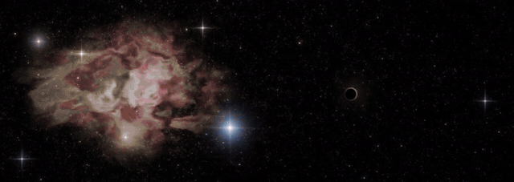

# NeonCosmos

[English](README.md) | **Русский**

Скринсейвер для Windows на видеокарте, который реагирует на музыку: «Рождение вселенной».
Из пустоты вспыхивает точка, разлетаются частицы, растёт газовая туманность, вокруг зажигаются звёзды. Потом она растворяется, и на другом мониторе рождается следующая. Изредка по экрану медленно проплывает чёрная дыра и искривляет свет звёзд и газа вокруг себя, а мимо пролетает комета с двойным хвостом.



*Запись экрана в тестовом режиме (в окне). Вживую картинка чётче.*

## Что умеет

- **Пять разных туманностей** (лагуна, как у Ориона, «пузырь», «голова ведьмы», огненная) со своей композицией, цветами и «именными» звёздами. Всё рисуется шейдерами, никаких картинок в проекте нет.
- **Чёрная дыра с гравитационным линзированием**: звёзды и газ пересэмплируются через линзу точечной массы, получаются дуги и кольцо Эйнштейна, мягкая тень и тонкое фотонное кольцо.
- **Кометы** со светящейся головой, голубым газовым хвостом и изогнутым жёлтым пылевым. Хвосты покачиваются от «солнечного ветра» и мягко подрагивают на басах.
- **Реакция на музыку из колонок** (WASAPI loopback, микрофон не нужен). Реакция намеренно мягкая, без резких вспышек.
- **Рассчитан на несколько мониторов**: занимает весь виртуальный рабочий стол, туманности рождаются внутри одного монитора, а не на стыке между ними. С одним монитором автоматически переключается на раскладку для одного экрана.
- Настоящая заставка `.scr`: окно настроек (`/c`), защита от двойного запуска.

## Что нужно

- Windows 10 / 11
- Видеокарта с OpenGL 3.3 (любая дискретная или относительно новая встроенная)
- Python 3 (проверено на 3.14), только если запускаете из исходников

## Запуск из исходников

```bash
pip install -r requirements.txt
python neon_cosmos.py window     # тест в окне
python neon_cosmos.py /s         # на весь экран на всех мониторах (любая клавиша или движение мыши закрывают)
python neon_cosmos.py /c         # окно настроек
```

Клавиши в режиме `window`: `S` скриншот, `N` следующая туманность, `H` чёрная дыра сейчас, `C` комета сейчас, `Esc` выход.
В заголовке окна показан текущий FPS.

## Установка как заставки

```bash
pip install pyinstaller
python -m PyInstaller --onefile --noconsole --hidden-import pyaudiowpatch --hidden-import moderngl --collect-all moderngl --name NeonCosmos neon_cosmos.py
```

Переименуйте `dist\NeonCosmos.exe` в `NeonCosmos.scr`, скопируйте в `C:\Windows\System32` (нужны права администратора) и выберите в *Параметры → Персонализация → Экран блокировки → Параметры заставки*.

## Настройки

Окно `/c` сохраняет их в `~/.neon_cosmos_config.json`: количество частиц взрыва, скорость газа, секунд на одну туманность, сила свечения, сила и частота чёрной дыры, яркость и частота комет (0 выключает дыры или кометы).

Остальные ручки это константы в начале `neon_cosmos.py`: `BEAT_STRENGTH` (реакция на басы), `EXPOSURE`, `NEB_GAIN`, `LENS_SIZE` и другие.

**Если мало FPS** (ниже ~45, смотрите заголовок окна или лог), поставьте `NEB_DIV = 4` или `SCENE_SCALE = 0.75`.

Лог пишется в `~/.neon_cosmos.log` (название видеокарты, раскладка мониторов, FPS, ошибки).

## Как это устроено (коротко)

Всё рисуют шейдеры через ModernGL: газ туманностей это фрактальный шум с искажением координат в 1/3 разрешения, звёзды это слои на хеш-сетке, частицы взрыва это квады, которые строятся прямо в вершинном шейдере, свечение даёт пирамида размытия из 4 уровней и тональная компрессия. Чёрная дыра это уравнение линзы, применённое к координатам, по которым считаются газ и звёзды. Звук снимается через `pyaudiowpatch` (WASAPI loopback), басовая полоса анализируется через FFT, а детектор ударов управляет мягкими пульсациями.

## Известные ограничения

- Только Windows (WASAPI loopback, вызовы Win32).
- Проверено на одном компьютере и одной видеокарте. На других (AMD, встроенная Intel) возможны странности шейдеров. Откройте issue и приложите `~/.neon_cosmos.log`.
- Линзирование это модель точечной массы: выглядит убедительно, но не является точной физической симуляцией чёрной дыры.

## О создании

Написано вместе с ИИ-ассистентом (Claude) и настроено вручную за много итераций со скриншотами и отзывами.

## Лицензия

MIT, см. [LICENSE](LICENSE).
